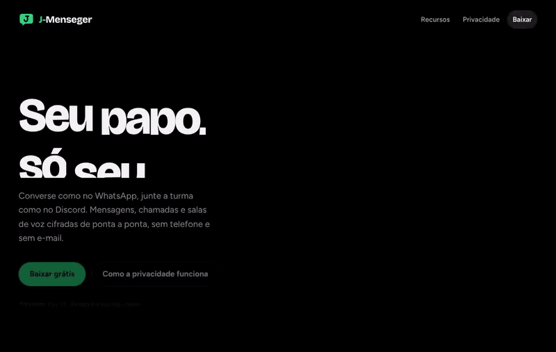
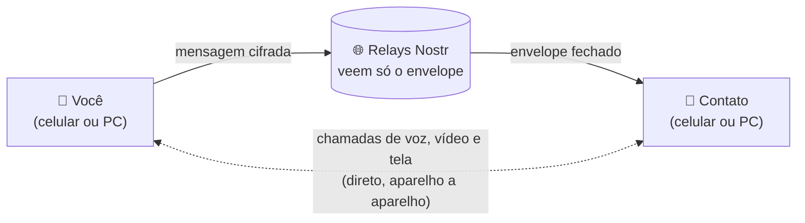

<div align="center">


# J-Menseger

**Converse como no WhatsApp, junte a turma como no Discord.**
Mensagens, chamadas e salas de voz cifradas de ponta a ponta, sem telefone e sem e-mail.

[🌐 **Site oficial**](https://jmenseger-site.vercel.app/) · [📥 **Baixar**](https://jmenseger-site.vercel.app/#baixar) · [🔐 **Privacidade**](#-privacidade)

<br />




</div>

---

## 🧭 Índice

- [Sobre](#-sobre)
- [Recursos](#-recursos)
- [Privacidade](#-privacidade)
- [Telas](#-telas)
- [Instalação](#-instalação)
- [Stack e arquitetura](#-stack-e-arquitetura)
- [Permissões do Android](#-permissões-do-android)
- [Estrutura do repositório](#-estrutura-do-repositório)
- [Créditos](#-créditos)
- [Perguntas frequentes](#-perguntas-frequentes)

---

## 💬 Sobre

O **J-Menseger** é um app de mensagens para grupos de amigos. Ele tem:

- **Conversas** de texto, voz, fotos e GIFs, com resposta, reação e "apagar para todos";
- **Grupos** com canais de texto e **salas de voz**, no estilo de um servidor do Discord;
- **Chamadas de voz e vídeo**, com transmissão de tela do PC para quem está no celular ou em outro PC;
- **Criptografia de ponta a ponta**: sua conta é um par de chaves criado no seu próprio aparelho.

Não existe cadastro com telefone ou e-mail. O app roda em **Windows** e **Android**, e as duas versões conversam entre si.

---

## ✨ Recursos

> Clique em cada categoria para ver os detalhes.

<details>
<summary><b>💬 Conversar</b></summary>

<br />

- Mensagens de texto, voz e fotos, com **resposta**, **reação** e **apagar para todos**
- **GIFs** da busca do GIPHY ou da galeria, animados dentro da conversa
- **Mensagens temporárias** que somem dos dois aparelhos
- **Recibos de leitura** e indicador de **"digitando…"**, que podem ser desligados


</details>

<details>
<summary><b>🎙️ Juntar a turma</b></summary>

<br />

- **Grupos** com canais de texto e **salas de voz**
- **Chamadas de voz e vídeo**, com tela cheia no computador
- **Soundboard**: aplausos, "ba dum tss" e seus próprios sons, tocados para todos na chamada
- **Transmissão de tela** do PC para quem está no celular ou em outro PC

</details>

<details>
<summary><b>🎨 Ser você</b></summary>

<br />

- **Banner e foto** de perfil, recortados no próprio aparelho
- **Jogos favoritos** fixados no perfil
- **Integração com o Spotify**: seus contatos veem a música que está tocando, se você quiser
- **Tema**: cores do app personalizáveis, com verde como padrão

</details>

<details>
<summary><b>🔒 Segurança da conta</b></summary>

<br />

- **PIN** e **bloqueio de capturas de tela** para quem divide o aparelho
- **12 palavras** para recuperar a conta. Anote no papel: nem o projeto consegue recuperá-la sem elas
- **Número de segurança** por contato, para conferir se a conversa é realmente com a pessoa

</details>

<details>
<summary><b>🖥️ Versão para computador</b></summary>

<br />

- Barra de grupos e salas de voz no estilo Discord
- Tour pela versão de computador:


</details>

---

## 🔐 Privacidade

O J-Menseger foi desenhado para que **o servidor entregue as mensagens, mas não consiga lê-las**.

| Dado | Você e seus contatos | Os servidores |
|---|:---:|:---:|
| Texto, fotos, áudios e GIFs | ✅ veem | ❌ não veem |
| Quem mandou cada mensagem | ✅ veem | ❌ não veem |
| Para quem a mensagem vai | ✅ veem | ⚠️ só o destinatário, para conseguir entregar |
| Voz e vídeo das chamadas | ✅ ouvem e veem | ❌ não passam por eles: vão direto de aparelho para aparelho |
| Número de telefone ou e-mail | — não existem | — não existem |

<details>
<summary><b>Como a criptografia funciona</b></summary>

<br />

1. Sua conta é um **par de chaves** gerado no seu aparelho.
2. Cada mensagem sai **trancada com a chave de quem vai receber**.
3. Ela passa por servidores públicos (*relays*) que só enxergam um **envelope fechado**.
4. Só o destinatário tem a chave para abrir.

O protocolo é aberto ([Nostr](https://nostr.com/)). **Não há um servidor dono das suas conversas.**

</details>

<details>
<summary><b>Relays padrão e como trocar</b></summary>

<br />

O app já vem com alguns relays públicos configurados. Você pode adicionar, remover ou trocar por um servidor próprio nas configurações:

- `wss://relay.damus.io`
- `wss://relay.primal.net`
- `wss://nos.lol`
- `wss://relay.0xchat.com`

</details>

---

## 📸 Telas

<table>
  <tr>
    <td align="center"><b>Conversa (PC)</b><br /></td>
    <td align="center"><b>Perfil (PC)</b><br /></td>
  </tr>
</table>

<details>
<summary><b>📱 Ver telas do celular</b></summary>

<br />

<table>
  <tr>
    <td align="center"><b>Conversa com GIF</b><br /></td>
    <td align="center"><b>Perfil com Spotify</b><br /></td>
    <td align="center"><b>Chamada com tela compartilhada</b><br /></td>
  </tr>
</table>

</details>

---

## 📥 Instalação

Os arquivos estão em **[jmenseger-site.vercel.app](https://jmenseger-site.vercel.app/#baixar)**.

| Plataforma | Versão | Tamanho | Requisito |
|---|---|---|---|
| Windows | 0.4.0 | ~36 MB | Windows 10 ou 11 |
| Android | 0.5.0 beta | ~0,7 MB | Android 8 ou mais novo |

<details>
<summary><b>🪟 Windows</b></summary>

<br />

1. Abra o instalador baixado (`J-Menseger-0.4.0-instalador.exe`).
2. Se aparecer **"O Windows protegeu o computador"**, clique em **Mais informações** e depois em **Executar assim mesmo**.
3. Clique em **Instalar**. O J-Menseger abre sozinho no final.

</details>

<details>
<summary><b>🤖 Android</b></summary>

<br />

1. Abra o arquivo `.apk` baixado no celular.
2. Se o Android pedir, permita **instalar apps desta fonte**.
3. Crie sua conta ou toque em **Restaurar com suas 12 palavras**.

> ⚠️ **Tinha a versão 0.4?** Anote suas 12 palavras, desinstale a versão antiga e instale a 0.5. Ela **não instala por cima** da anterior.

</details>

---

## 🛠️ Stack e arquitetura

| Parte | Tecnologia |
|---|---|
| App de computador | **Rust** (com `nostr-sdk`) + **JavaScript** na interface, instalador NSIS |
| App Android | Interface web empacotada em um **WebView** (a mesma interface do PC) |
| Interface web | **JavaScript** com `nostr-tools` |
| Protocolo | **Nostr** (relays públicos, sem servidor central) |
| Fontes | Bricolage Grotesque e Figtree |

<details>
<summary><b>Diagrama: como uma mensagem viaja</b></summary>

<br />



</details>

---

## 📱 Permissões do Android

O APK pede estas permissões (lidas do `AndroidManifest.xml`). As finalidades marcadas com ⚙️ são inferidas do nome da permissão, então confira antes de publicar.

| Permissão | Para que serve |
|---|---|
| `INTERNET`, `ACCESS_NETWORK_STATE` | Conectar aos relays e saber se há rede |
| `CAMERA` | Chamadas de vídeo |
| `RECORD_AUDIO` | Chamadas de voz, áudios e salas de voz |
| `POST_NOTIFICATIONS` | Avisar sobre novas mensagens e chamadas |
| `FOREGROUND_SERVICE` (com `_CAMERA`, `_MICROPHONE`, `_REMOTE_MESSAGING`) | Manter chamadas e recebimento de mensagens ativos em segundo plano |
| `USE_FULL_SCREEN_INTENT` ⚙️ | Mostrar a tela de chamada recebida |
| `WAKE_LOCK`, `RECEIVE_BOOT_COMPLETED` ⚙️ | Manter o recebimento de mensagens após reinício |
| `REQUEST_IGNORE_BATTERY_OPTIMIZATIONS` ⚙️ | Evitar que o sistema pause o app e perca mensagens |
| `VIBRATE`, `MODIFY_AUDIO_SETTINGS` ⚙️ | Vibração e controle de som do soundboard e das chamadas |
| `BLUETOOTH_CONNECT` ⚙️ | Usar fones e acessórios Bluetooth nas chamadas |

---

## 📂 Estrutura do repositório

```text
j-menseger/
├── README.md
└── docs/
    ├── gifs/          # animações usadas no README
    ├── img/           # capturas de tela e logo
    └── LICENCA-sons.txt # licenças dos sons do soundboard
```

> O código-fonte do app será incluído aqui.

---

## 🙏 Créditos

- **Fontes**: *Bricolage Grotesque* e *Figtree*, sob licença SIL Open Font License (OFL).
- **Sons do soundboard**: amostras do **MuseScore General** (MIT, com partes em domínio público ou CC0), do **Fluid (R3) GM SoundFont** (MIT) e do **Fluid (R3) Mono GM** (Michael Cowgill). O som de "grilos" é sintetizado. Detalhes em [`assets/www/sounds/LICENCA.txt`](docs/LICENCA-sons.txt).
- **Protocolo**: [Nostr](https://nostr.com/).

---

## ❓ Perguntas frequentes

<details>
<summary><b>O Windows bloqueou o instalador. É vírus?</b></summary>

<br />

Não. O Windows mostra esse aviso para programas novos que ainda não têm reputação. Clique em **Mais informações** e depois em **Executar assim mesmo**.

</details>

<details>
<summary><b>Perdi as 12 palavras. Consigo recuperar a conta?</b></summary>

<br />

Não. Sem as 12 palavras ninguém consegue recuperar a conta, nem o projeto. Guarde-as num papel, em um lugar seguro.

</details>

<details>
<summary><b>Posso usar no celular e no PC ao mesmo tempo?</b></summary>

<br />

Sim. As duas versões falam a mesma língua: mensagens, chamadas, GIFs e a tela compartilhada passam de um para o outro.

</details>

<details>
<summary><b>Encontrei um erro. Como reporto?</b></summary>

<br />

Por enquanto as versões são de teste. Mande o que deu errado para quem te convidou.

</details>

---

<div align="center">

Feito com ❤️ em **Rust** e **JavaScript**, sobre o protocolo **Nostr**.

</div>
