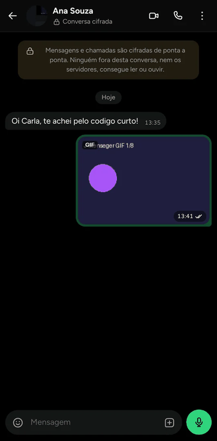
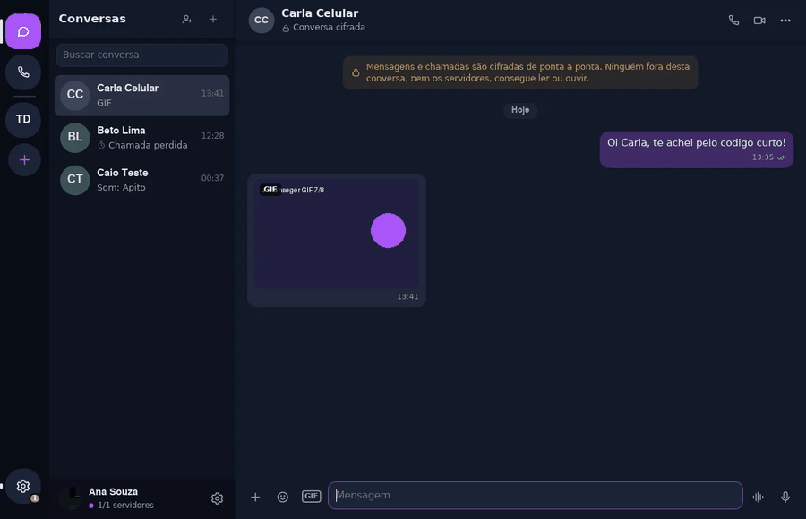
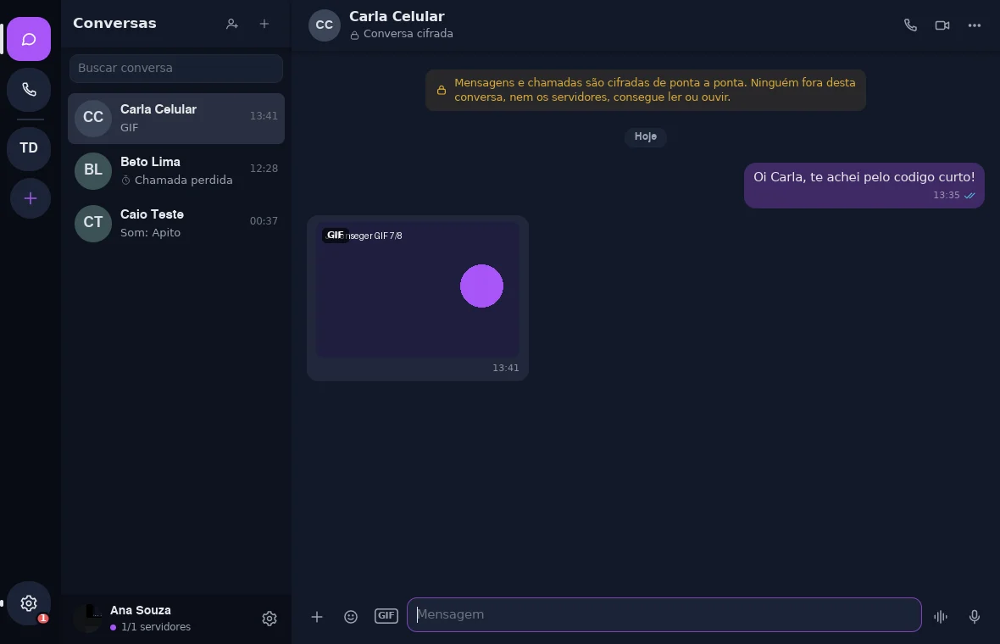
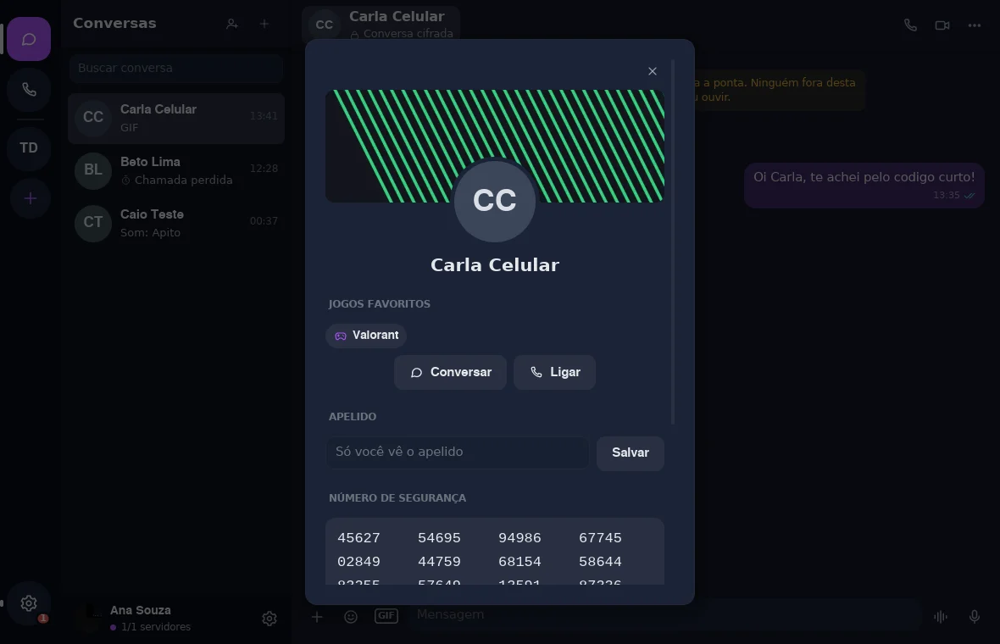
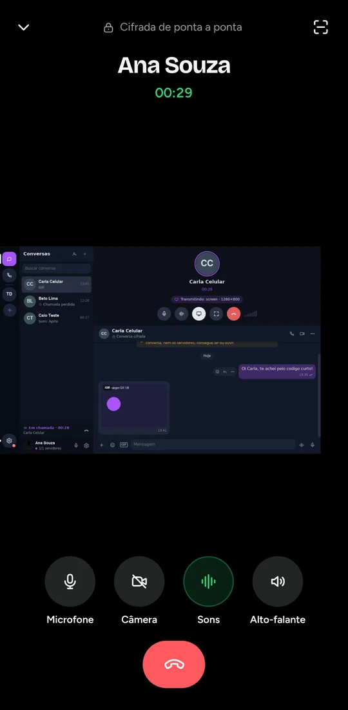
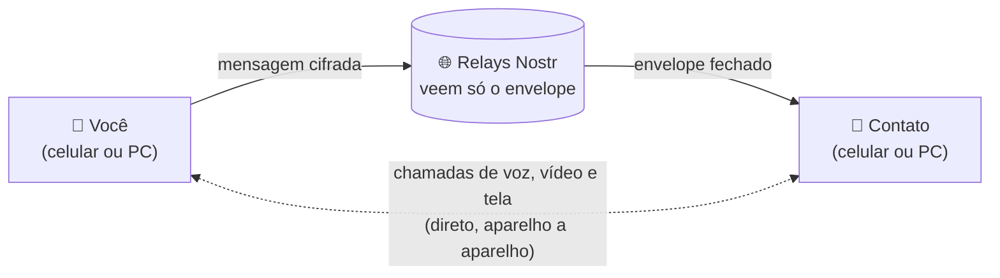

<div align="center">


# J-Menseger

**Converse como no WhatsApp, junte a turma como no Discord.**
Mensagens, chamadas e salas de voz cifradas de ponta a ponta, sem telefone e sem e-mail.

[🌐 **Site oficial**](https://jmenseger-site.vercel.app/) · [📥 **Baixar**](https://jmenseger-site.vercel.app/#baixar) · [🔐 **Privacidade**](#-privacidade)

<br />


</div>

---

## 🧭 Índice

- [Sobre](#-sobre)
- [Recursos](#-recursos)
- [Privacidade](#-privacidade)
- [Telas](#-telas)
- [Instalação](#-instalação)
- [Stack e arquitetura](#-stack-e-arquitetura)
- [Permissões do Android](#-permissões-do-android)
- [Estrutura do repositório](#-estrutura-do-repositório)
- [Créditos](#-créditos)
- [Perguntas frequentes](#-perguntas-frequentes)

---

## 💬 Sobre

O **J-Menseger** é um app de mensagens para grupos de amigos. Ele tem:

- **Conversas** de texto, voz, fotos e GIFs, com resposta, reação e "apagar para todos";
- **Grupos** com canais de texto e **salas de voz**, no estilo de um servidor do Discord;
- **Chamadas de voz e vídeo**, com transmissão de tela do PC para quem está no celular ou em outro PC;
- **Criptografia de ponta a ponta**: sua conta é um par de chaves criado no seu próprio aparelho.

Não existe cadastro com telefone ou e-mail. O app roda em **Windows**, **Linux**, **macOS** e **Android**, e todas as versões conversam entre si.

---

## ✨ Recursos

> Clique em cada categoria para ver os detalhes.

<details>
<summary><b>💬 Conversar</b></summary>

<br />

- Mensagens de texto, voz e fotos, com **resposta**, **reação** e **apagar para todos**
- **Responder e marcar como lida** direto pela notificação
- **Encaminhar** mensagens e **enviar arquivos** de até 5 MB
- **Foto e áudio de visualização única**
- **Prévia de links** dentro da conversa
- **GIFs** da busca do GIPHY ou da galeria, animados dentro da conversa
- **Mensagens temporárias** que somem dos dois aparelhos
- **Recibos de leitura** e indicador de **"digitando…"**, que podem ser desligados



</details>

<details>
<summary><b>🎙️ Juntar a turma</b></summary>

<br />

- **Grupos** com canais de texto e **salas de voz**
- **Poderes por cargo** dentro do grupo
- **Eventos do grupo** com lista de presença e lembrete
- **Chamadas de voz e vídeo**, com tela cheia no computador
- **Volume ajustável para cada pessoa** na chamada
- **Soundboard**: aplausos, "ba dum tss" e seus próprios sons, tocados para todos na chamada
- **Transmissão de tela** do PC para quem está no celular ou em outro PC, com **áudio do PC** (Windows)

</details>

<details>
<summary><b>🎨 Ser você</b></summary>

<br />

- **Banner e foto** de perfil, recortados no próprio aparelho
- **Jogos favoritos** fixados no perfil
- **Status personalizado**, com modo **Não perturbe**
- **Integração com o Spotify**: seus contatos veem a música que está tocando, se você quiser
- **Tema**: cores do app personalizáveis, com verde como padrão

</details>

<details>
<summary><b>🔒 Segurança da conta</b></summary>

<br />

- **PIN** e **bloqueio de capturas de tela** para quem divide o aparelho
- **12 palavras** para recuperar a conta. Anote no papel: nem o projeto consegue recuperá-la sem elas
- **Número de segurança** por contato, para conferir se a conversa é realmente com a pessoa
- **Lista de aparelhos conectados**, para ver onde a sua conta está aberta

</details>

<details>
<summary><b>🖥️ Versão para computador</b></summary>

<br />

- Disponível para **Windows**, **Linux** e **macOS**
- Barra de grupos e salas de voz no estilo Discord
- Ícone na bandeja, abrir ao ligar e **atualização automática** (por enquanto, só no Windows)
- Tour pela versão de computador:



</details>

---

## 🔐 Privacidade

O J-Menseger foi desenhado para que **o servidor entregue as mensagens, mas não consiga lê-las**.

| Dado | Você e seus contatos | Os servidores |
|---|:---:|:---:|
| Texto, fotos, áudios e GIFs | ✅ veem | ❌ não veem |
| Quem mandou cada mensagem | ✅ veem | ❌ não veem |
| Para quem a mensagem vai | ✅ veem | ⚠️ só o destinatário, para conseguir entregar |
| Voz e vídeo das chamadas | ✅ ouvem e veem | ❌ não passam por eles: vão direto de aparelho para aparelho |
| Número de telefone ou e-mail | — não existem | — não existem |

<details>
<summary><b>Como a criptografia funciona</b></summary>

<br />

1. Sua conta é um **par de chaves** gerado no seu aparelho.
2. Cada mensagem sai **trancada com a chave de quem vai receber**.
3. Ela passa por servidores públicos (*relays*) que só enxergam um **envelope fechado**.
4. Só o destinatário tem a chave para abrir.

O protocolo é aberto ([Nostr](https://nostr.com/)). **Não há um servidor dono das suas conversas.**

</details>

<details>
<summary><b>Relays padrão e como trocar</b></summary>

<br />

O app já vem com alguns relays públicos configurados. Você pode adicionar, remover ou trocar por um servidor próprio nas configurações:

- `wss://relay.damus.io`
- `wss://relay.primal.net`
- `wss://nos.lol`
- `wss://relay.0xchat.com`

</details>

---

## 📸 Telas

<table>
  <tr>
    <td align="center"><b>Conversa (PC)</b><br /></td>
    <td align="center"><b>Perfil (PC)</b><br /></td>
  </tr>
</table>

<details>
<summary><b>📱 Ver telas do celular</b></summary>

<br />

<table>
  <tr>
    <td align="center"><b>Conversa com GIF</b><br /></td>
    <td align="center"><b>Perfil com Spotify</b><br /></td>
    <td align="center"><b>Chamada com tela compartilhada</b><br /></td>
  </tr>
</table>

</details>

> ℹ️ As telas são da versão que está no site. Se a interface mudou depois disso, as capturas podem estar um pouco desatualizadas.

---

## 📥 Instalação

Os arquivos estão no **[site oficial](https://jmenseger-site.vercel.app/#baixar)** e também neste repositório, em [`j-menseger-site/downloads/`](j-menseger-site/downloads/).

| Plataforma | Versão | Tamanho | Requisito |
|---|---|---|---|
| Windows | 0.6.0 | ~37 MB | Windows 10 ou 11 |
| Linux | 0.6.0 | ~16 MB (`.deb`) ou ~21 MB (`.tar.gz`) | Ubuntu 22.04+, Debian 12+, Fedora 36+ ou Mint 21+ |
| macOS | 0.6.0 | ~17 MB (Apple Silicon) ou ~19 MB (Intel) | macOS 11 (Big Sur) ou mais novo |
| Android | 0.7.0 beta | ~0,7 MB | Android 8 ou mais novo |

<details>
<summary><b>🪟 Windows</b></summary>

<br />

[](https://jmenseger-site.vercel.app/downloads/J-Menseger-0.6.0-instalador.exe)

Ou pelo repositório: [`J-Menseger-0.6.0-instalador.exe`](j-menseger-site/downloads/J-Menseger-0.6.0-instalador.exe)

1. Abra o instalador baixado.
2. Se aparecer **"O Windows protegeu o computador"**, clique em **Mais informações** e depois em **Executar assim mesmo**.
3. Clique em **Instalar**. O J-Menseger abre sozinho no final.

<details>
<summary>🔐 SHA-256 deste arquivo</summary>

```text
0470858093217854446b0d4bd8b50f3e1ab6e61ed95bf2e4da4300e23c21b296  J-Menseger-0.6.0-instalador.exe
```

</details>

</details>

<details>
<summary><b>🐧 Linux</b></summary>

<br />

Escolha um dos dois arquivos:

**`.deb`** (Ubuntu, Debian, Mint)

[](https://jmenseger-site.vercel.app/downloads/J-Menseger-0.6.0-linux-amd64.deb)

Ou pelo repositório: [`J-Menseger-0.6.0-linux-amd64.deb`](j-menseger-site/downloads/J-Menseger-0.6.0-linux-amd64.deb). Depois, abra o arquivo e clique em **Instalar**, ou no terminal:

```bash
sudo apt install ./J-Menseger-0.6.0-linux-amd64.deb
```

**`.tar.gz`** (qualquer distribuição, sem `sudo`)

[](https://jmenseger-site.vercel.app/downloads/J-Menseger-0.6.0-linux-x86_64.tar.gz)

Ou pelo repositório: [`J-Menseger-0.6.0-linux-x86_64.tar.gz`](j-menseger-site/downloads/J-Menseger-0.6.0-linux-x86_64.tar.gz). Extraia e rode o instalador de dentro da pasta. Ele instala só para você:

```bash
tar -xzf J-Menseger-0.6.0-linux-x86_64.tar.gz
cd J-Menseger-0.6.0-linux-x86_64
./instalar.sh
```

<details>
<summary>🔐 SHA-256 destes arquivos</summary>

```text
0f6327542a4cac4b861248e2e3c4109815c8dc48739b937d37208369c53d6a31  J-Menseger-0.6.0-linux-amd64.deb
9749f147aa8a06dbf23fd3e1a6735bbb366759d9cea2cc7b3a48f89fb8e6a28d  J-Menseger-0.6.0-linux-x86_64.tar.gz
```

</details>

</details>

<details>
<summary><b>🍎 macOS</b></summary>

<br />

Primeiro, confira o seu Mac em **Menu Apple → Sobre este Mac**. Se aparecer "Chip: Apple M…", use o **Apple Silicon**. Se aparecer "Processador Intel", use o **Intel**.

[](https://jmenseger-site.vercel.app/downloads/J-Menseger-0.6.0-macos-arm64.dmg)
[](https://jmenseger-site.vercel.app/downloads/J-Menseger-0.6.0-macos-x86_64.dmg)

Ou pelo repositório: [Apple Silicon](j-menseger-site/downloads/J-Menseger-0.6.0-macos-arm64.dmg) · [Intel](j-menseger-site/downloads/J-Menseger-0.6.0-macos-x86_64.dmg)

1. Abra o `.dmg` e arraste o J-Menseger para a pasta **Aplicativos**.
2. Na primeira vez, o macOS avisa que não pôde verificar o app. Vá em **Ajustes do Sistema → Privacidade e Segurança** e clique em **Abrir Mesmo Assim**.

> ℹ️ O app não passa pela notarização da Apple (que exige uma conta paga). Por isso esse aviso aparece na primeira vez.

<details>
<summary>🔐 SHA-256 destes arquivos</summary>

```text
f6cca9c42da6db8cda8d6dd3eb03394ec35d9ee08f7e4d51248c0b8f4c902f92  J-Menseger-0.6.0-macos-arm64.dmg
5c0aa7d7fb359024bddc679bce7ae9277284a6f831d9c6f7b3c6c423e97ca31e  J-Menseger-0.6.0-macos-x86_64.dmg
```

</details>

</details>

<details>
<summary><b>🤖 Android</b></summary>

<br />

[](https://jmenseger-site.vercel.app/downloads/J-Menseger-0.7.0-beta.apk)

Ou pelo repositório: [`J-Menseger-0.7.0-beta.apk`](j-menseger-site/downloads/J-Menseger-0.7.0-beta.apk)

1. Abra o arquivo `.apk` baixado no celular.
2. Se o Android pedir, permita **instalar apps desta fonte**.
3. Crie sua conta ou toque em **Restaurar com suas 12 palavras**.

O app traz um atualizador próprio, para baixar e instalar novas versões sem precisar voltar ao site.

<details>
<summary>🔐 SHA-256 deste arquivo</summary>

```text
db6b94f7160da06ab9f8aa8e7dfdfe09553e8490c968912a82ca0d48d769f7e1  J-Menseger-0.7.0-beta.apk
```

</details>

</details>

---

## 🛠️ Stack e arquitetura

| Parte | Tecnologia |
|---|---|
| App de computador | **Rust puro** com interface **Iced 0.14**, desenhada pela GPU via `wgpu` (com retorno por software). Sem WebView, Electron ou Tauri |
| Protocolo (PC) | Crate **`nostr` 0.45** (rust-nostr) |
| Chamadas (PC) | **webrtc-rs**, o mesmo transporte do celular. Vídeo com **libvpx** (a única parte em C) |
| Pacotes (PC) | `.exe` para Windows, `.deb` e `.tar.gz` para Linux, `.dmg` para macOS (Apple Silicon e Intel) |
| App Android | Interface web (**HTML, CSS e JavaScript** com `nostr-tools`) dentro de um **WebView**, com uma camada **Java** fina para Keystore, notificações, chamada em tela cheia, transmissão de tela e atualização |
| Protocolo (celular) | **Nostr** (relays públicos, sem servidor central) |
| Build dos pacotes | **GitHub Actions** ([`.github/workflows/pc.yml`](.github/workflows/pc.yml)), para Linux e macOS |
| Fontes | Bricolage Grotesque e Figtree |

> Os testes de compatibilidade entre PC e celular estão em [`j-menseger-desktop/crates/jm-core/tests/`](j-menseger-desktop/crates/jm-core/tests/).

### 📋 Status atual

| Área | Situação |
|---|---|
| Mensagens, grupos, salas de voz, soundboard, transmissão de tela, ajustes | ✅ Pronto no PC (conferido com o celular, detalhes em [`PARIDADE.md`](j-menseger-desktop/PARIDADE.md)) |
| Instalador e desinstalador no Linux | ✅ Testados no Linux |
| Executável e instalador do Windows | ⚠️ Gerados por compilação cruzada no Linux, **não testados num Windows** |
| Pacote do macOS | ⚠️ Gerado pelo GitHub Actions; a documentação do projeto **não registra teste num Mac** |
| Só no Windows | ⚠️ Ícone na bandeja, abrir ao ligar, áudio do PC na transmissão e atualização automática |
| Enviar a câmera do computador | ❌ Não implementado |
| Ler QR pela câmera | ❌ Não implementado |

<details>
<summary><b>Diagrama: como uma mensagem viaja</b></summary>

<br />



</details>

---

## 📱 Permissões do Android

O APK pede estas permissões (lidas do `AndroidManifest.xml` da versão 0.7.0 beta). As finalidades marcadas com ⚙️ são inferidas do nome da permissão, então confira antes de publicar.

| Permissão | Para que serve |
|---|---|
| `INTERNET`, `ACCESS_NETWORK_STATE` | Conectar aos relays e saber se há rede |
| `CAMERA` | Chamadas de vídeo |
| `RECORD_AUDIO` | Chamadas de voz, áudios e salas de voz |
| `POST_NOTIFICATIONS` | Avisar sobre novas mensagens e chamadas |
| `FOREGROUND_SERVICE` (com `_CAMERA`, `_MICROPHONE`, `_REMOTE_MESSAGING`, `_MEDIA_PROJECTION`) | Manter chamadas, recebimento de mensagens e transmissão de tela ativos em segundo plano |
| `FOREGROUND_SERVICE_MEDIA_PROJECTION` | Transmissão da tela do celular |
| `BIND_JOB_SERVICE` | Tarefas em segundo plano para receber mensagens (`WakeJob`) |
| `REQUEST_INSTALL_PACKAGES` | Baixar e instalar atualizações do próprio app (`Updater`) |
| `USE_FULL_SCREEN_INTENT` ⚙️ | Mostrar a tela de chamada recebida |
| `WAKE_LOCK`, `RECEIVE_BOOT_COMPLETED` ⚙️ | Manter o recebimento de mensagens após reinício |
| `REQUEST_IGNORE_BATTERY_OPTIMIZATIONS` ⚙️ | Evitar que o sistema pause o app e perca mensagens |
| `VIBRATE`, `MODIFY_AUDIO_SETTINGS` ⚙️ | Vibração e controle de som do soundboard e das chamadas |
| `BLUETOOTH_CONNECT` ⚙️ | Usar fones e acessórios Bluetooth nas chamadas |

---

## 📂 Estrutura do repositório

```text
j-menseger/
├── README.md
├── .github/workflows/pc.yml      # build do PC para Linux e macOS (GitHub Actions)
├── docs/                         # mídia deste README
│   ├── gifs/                     # animações
│   ├── img/                      # capturas de tela e logo
│   └── LICENCA-sons.txt          # licenças dos sons do soundboard
├── j-menseger-desktop/           # app de computador (Rust + Iced)
│   ├── README.md                 # como compilar e rodar
│   ├── ARQUITETURA.md            # decisões técnicas
│   ├── PARIDADE.md               # comparação item a item com o celular
│   ├── crates/                   # jm-core, jm-app, jm-media
│   ├── packaging/                # linux/, macos/ e windows/: gera os pacotes
│   └── tools/                    # servidor de teste e ferramentas auxiliares
├── j-menseger-android/           # app Android (WebView + Java)
│   ├── README.md                 # como montar e de onde veio o código
│   ├── ESTUDO-IPHONE.md          # estudo de compatibilidade com iPhone
│   ├── web/                      # interface web (HTML, CSS, JS)
│   ├── android/                  # camada Java
│   └── dist/                     # APK gerado
└── j-menseger-site/              # site de divulgação e downloads
    ├── versao.json               # versões, tamanhos e SHA-256 dos downloads
    ├── downloads/                # instaladores e APK
    └── tools/gerar-versao.sh     # gera o versao.json
```

> ℹ️ A pasta `j-menseger-android/` foi reconstruída a partir do APK 0.4.0-beta, porque o código-fonte original se perdeu. Veja o [README dela](j-menseger-android/README.md) para os detalhes.

---

## 🙏 Créditos

- **Fontes**: *Bricolage Grotesque* e *Figtree*, sob licença SIL Open Font License (OFL).
- **Sons do soundboard**: amostras do **MuseScore General** (MIT, com partes em domínio público ou CC0), do **Fluid (R3) GM SoundFont** (MIT) e do **Fluid (R3) Mono GM** (Michael Cowgill). O som de "grilos" é sintetizado. Detalhes em [`docs/LICENCA-sons.txt`](docs/LICENCA-sons.txt).
- **Protocolo**: [Nostr](https://nostr.com/).

---

## ❓ Perguntas frequentes

<details>
<summary><b>O Windows bloqueou o instalador. É vírus?</b></summary>

<br />

Não. O Windows mostra esse aviso para programas novos que ainda não têm reputação. Clique em **Mais informações** e depois em **Executar assim mesmo**.

</details>

<details>
<summary><b>O macOS diz que o app não pôde ser verificado. O que faço?</b></summary>

<br />

É o comportamento esperado na primeira vez, porque o app não é notarizado pela Apple. Vá em **Ajustes do Sistema → Privacidade e Segurança** e clique em **Abrir Mesmo Assim**.

</details>

<details>
<summary><b>Qual arquivo do Linux eu escolho?</b></summary>

<br />

Se você usa Ubuntu, Debian ou Mint, o `.deb` é o mais simples. Em outras distribuições, use o `.tar.gz`, que instala só para você e não precisa de `sudo`.

</details>

<details>
<summary><b>Perdi as 12 palavras. Consigo recuperar a conta?</b></summary>

<br />

Não. Sem as 12 palavras ninguém consegue recuperar a conta, nem o projeto. Guarde-as num papel, em um lugar seguro.

</details>

<details>
<summary><b>Posso usar no celular e no PC ao mesmo tempo?</b></summary>

<br />

Sim. As versões falam a mesma língua: mensagens, chamadas, GIFs e a tela compartilhada passam de um para o outro.

</details>

<details>
<summary><b>Encontrei um erro. Como reporto?</b></summary>

<br />

Por enquanto as versões são de teste. Mande o que deu errado para quem te convidou.

</details>

---

<div align="center">

Feito com ❤️ em **Rust** e **JavaScript**, sobre o protocolo **Nostr**.

</div>
